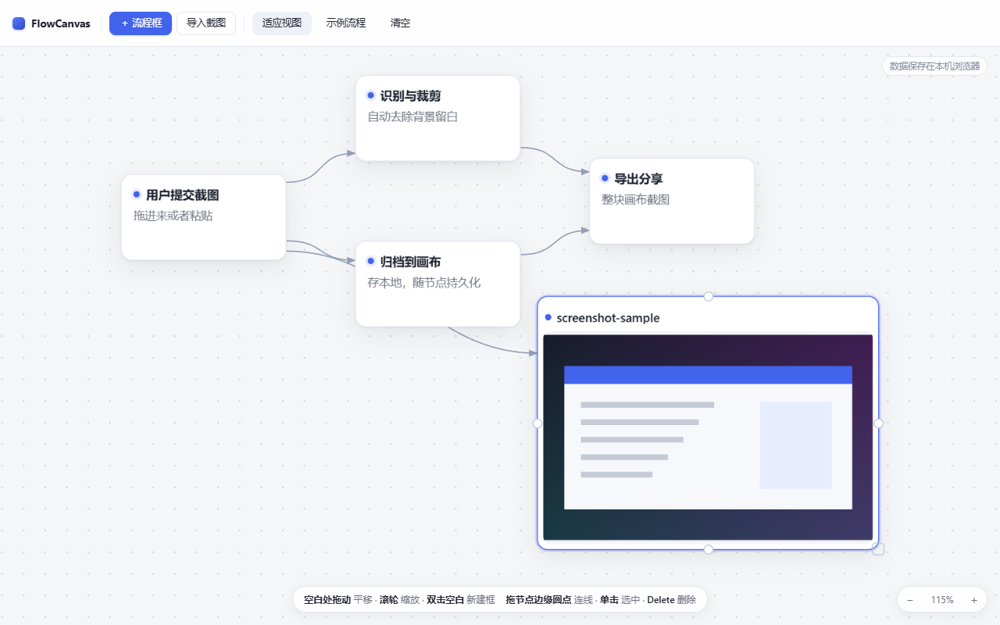
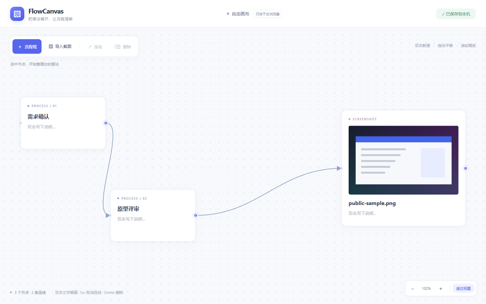

# 自由画布团队交付基线

2026-11-18，使用启动测试时最新的 `origin/main@f8323e08`、默认模型 DeepSeek Flash、独立 Web 实例与五个全新 Bot 会话。团队从只有 README 的本地 Git 项目交付了可打开的自由画布。首次需求在 17:07:38 进入 Master 私聊，17:38:01 收到最终答复，历时约 30 分 24 秒。前半部分记录改造前的基线，文末按相同场景对照 PR #248 的真实实现。

## 谁做了什么

| 用户动作或构建事件 | 实际行为 |
|---|---|
| 私聊 Master，请先讨论原型再开发 | Master 给出可操作原型及澄清卡。用户在原卡片自由回答“删除节点时，同时删除与它关联的所有连线”，Web 返回 200。最终产品执行了这个选择。 |
| Master 在群内分派并行开发 | 画布开发负责渲染、拖动和连线，截图开发负责图片导入与保存。两者分别在自己的工作树编写、提交和落地代码。 |
| 用户在群里说“确认版原型已经放在 Master 的项目目录，供大家查阅。” | 五人都收到发言及回应请求。画布开发和交互测试直接引用通知回帖，前者确认收到既有分派，后者宣布编写清单。其余三人没有发出归属于这条通知的群帖。 |
| 用户只在截图开发私聊提供带独特标记的样图，再告诉 Master 此项已有负责人 | 截图开发取用的文件与用户上传的 PNG 字节哈希一致，验证后在原私聊告知结果。Master 最终带回结论。群记录未出现样图标记，交付包未包含该图或标记。 |
| 转发集成构建结果，重复同一构建编号 | 正式程序的 `422cde8` 由观察端独立检出并构建成功。相同正文经两次独立用户投递进入 Master 私聊。两位测试已在群内接手各自方向，未观察到回执重发触发第二套测试分派。没有观察到预期的“构建后由 Master 首次显式分派两项测试”，后续有针对真实缺陷的复验请求。 |
| 用户在群里点名询问 50% 缩放下拖动截图节点的表现 | 交互测试先说明占位版无法验证。Master 在原型上报告近似缩放值，交互测试随后在正式画布上把精确 50% 的实测结果发回群里。 |
| 达到通信额度后收尾 | Master 私聊提示与交互测试的交流已达上限。用户同意继续，要求只复验受影响项并交付。Master 私聊提供了启动入口、成品截图、样图结论及已知限制。 |

## 消息及重复工作

| 观测 | 收件侧证据 |
|---|---|
| 群消息 | 群里共 45 条，含用户 2 条、Bot 43 条。按发送人以外的群成员逐条核对消息 ID，应有 182 份，实际 182 份，各一份。 |
| 同事私信 | 20 条确认送达。按消息 ID、发送人、收件人、正文核对，20 条都在正确对方出现一次。8 条用户私聊输入也分别出现在指定会话。澄清卡的回答另计。 |
| 实际未送达 | 另有 5 次发送被拒。1 次群发送多传了 `message_id` 参数。4 次达到同一来源的消息上限，其中 3 次同事私信、1 次群发言。恢复测试在群内发不出复验结果后，转而在用户私聊请求代为转达。 |
| 用户实际可见的普通正文 | 从首次需求起，五个 Bot 私聊共出现 81 段带正文的工作步骤。Master 35、画布开发 12、截图开发 13、交互测试 14、恢复测试 7。包括必要答复、过程播报和上限提示。计数来自会话界面的数据，不代表操作系统推送次数。 |
| 重复执行 | 私有样图验证有一位执行者。两份相同正式构建回执未引起重复派测。同时存在重复劳动：恢复测试自行在临时副本实现了两个修复，Master 已在正式代码里实现相同目标，随后要求作废临时补丁。只落地了一套修复。 |

## 成品复验与实验边界

成品集成提交为 `e9f34700bdafcdc5d1229910e7a9f4ee219b6937`。在单独检出的代码和 Master 给出的本地入口上分别用全新 Chromium 会话操作。新建并编辑两个流程框、导入一张公开样图、连接两条有向边、平移缩放和刷新均通过。在约 50% 缩放下拖动截图节点，实测连线端点到节点边界的距离为 0 像素。刷新后节点、连线、视图状态及图片保留，删除中间节点后两条关联边消失。中途发现的“双击已有框会另建一个重叠节点”也在最终版独立复验通过。交付 ZIP 解压后可用项目自己的构建脚本重建。

观察端通过真实 Web 客户端接口扮演用户，在浏览器卡片上作答，通过本地用户私聊转发真实构建回执。实验没有使用独立的 CI 推送连接。构建观察器最初把能编译的占位提交 `97d33f6` 识别成正式版，提前转发了两份骨架回执，点名的缩放问题也提前到达。原始事件全部保留。两位开发的实质代码均进入集成分支后，另对正式提交做了同编号重投。每次重投使用独立的用户消息 ID，考察语义重复，同一消息 ID 的网络重试未在本次注入。

本次只运行一次。一条通知引出了回帖，仍需按照内容判断它的价值。已确认送达的消息可以逐条核对，模型从未尝试发送的消息则只能按实验预设的必要交付判断。本 worktree 的 `.tools/baseline/` 下保留用户事件、构建回执、收件核对、问答与最终交付截图、浏览器验收结果及成品 ZIP。

## PR #248 实现后的同场复跑

2026-11-18，固定 [PR #248](https://github.com/firetoweak/konden/pull/248) 的 `7a9d888d`，在另一个只有 README 的项目里新建相同角色的五个 DeepSeek Flash Bot。首条需求、删除规则答复、归档通知与私有 PNG 沿用上一轮。17:57:09 需求进入 Master 私聊，18:36:34 用户收到 Master 的成品、入口及私有样图结论，约 39 分 24 秒。运行期间 PR 更新到 `cf9340cd`，两次提交间只改了压缩换窗测试的同步条件。

| 同一观测口径 | 改造前 | PR #248 |
|---|---:|---:|
| 首次需求至 Master 交付，五个用户私聊里可见的带正文步骤 | 81 | 22 |
| 群消息条数 / 在其他成员处逐 ID 核实的份数 | 45 / 182 份 | 35 / 142 份 |
| 已发送的同事私信在正确收件方出现一次 | 20/20 | 2/2 |
| 发送被拒的尝试 | 5 | 4 |
| 归档通知的直接引用回帖 | 2 | 0 |
| 同一正式构建以两个消息 ID 转发后，再分派一整套测试 | 0 | 0 |

**私聊安静了，但收件人仍会选错。** 22 段中，Master 5、画布开发 6、截图开发 7、交互测试 2、恢复测试 2。9 条显式私聊正文逐一对上对应会话的输出 ID，9 条文件说明可在原会话下载原大小的附件，另有 1 张澄清卡和 3 条通信上限提示。Master 交付约 10 秒后，画布开发又私聊了一次结项，计入这条则共 23 段。用户约定日常进展留群里，画布开发仍把两张过程图和自己的预览地址发给用户。用户点名要求在群里回答 50% 拖动问题，交互测试在原群给了正确读数，也另把截图发到了自己的用户私聊。

**群通知不再被直接回复，后续讨论仍在继续。** 五人都收到了同一条归档通知和回应请求。没有人引用它回“收到”。系统把后续 20 条群帖的来源追溯到这条通知，包括画布与截图模块对接、缺陷修复及验收；上一轮同一来源有 2 条。因此直接引用数只回答有没有直接回帖，无法代表整条讨论已经结束。35 条群消息应产生的 142 份成员收件均逐条、各一次出现。4 次明确拒发中，1 次引用无效，3 次达同一来源的交流上限（2 次群发送、1 次同事私信）。两位开发的修复汇报都曾因此转进用户私聊。

**样图与结论的可见范围有差别。** 截图开发先在自己的用户私聊发回实测截图。群里和成品包均未发现样图或独特标记，但群帖提前披露了与该次私聊测试一致的尺寸、坐标和刷新读数，超出“结果只在这里告诉我”的约定。之后它在私聊另问能否把一句结论给 Master。用户同意后，它通过同事私信发送这一句，Master 在最终私聊中带回。9 次用户私聊输入均可在指定会话核实，其中 1 次客户端等待超时，随后按原投递 ID 在日志及会话中确认已收到。澄清卡在原卡片作答，另计。

**重复回执和重复发言是两件事。** 两位开发的功能代码都进入集成提交 `c71db64` 后，观察端从干净检出实际构建，向 Master 两次转发相同正文及构建号。随后 Master 只发出一次覆盖两人的完整 QA 分派。两位测试在收到正式分派前已经动手，后续换版本后的局部回归有实际代码变化。另一次，截图开发认为工具超时，用新消息重新发布同一组测试读数。两条群帖相隔 18 秒，有不同的消息 ID，各自只投递一次。与上一轮相比，这次没有注入占位版构建回执，群里的 50% 问题也等到测试员已经打开正式产品才发。

**交付与人工介入。** 可运行成品在项目提交 `2a6950a`。观察端用全新浏览器分别验证了 Master 给出的本地入口及从源码重建、打包再解压的版本。两处均通过建框、编辑、导图、连线、平移、刷新和级联删除。在 50% 下水平拖动截图 115 像素，拖动后线端到节点边界相差约 0.02 像素。独立操作复现了早期版本打开第二标签页会清空原图的缺陷，在交付版用相同步骤确认两页都保留三个节点和两条线。

实验中 Master 和恢复测试分别因 Windows Git 临时文件占用各重试一次。两者做渲染进程崩溃测试时都遇到浏览器调用不返回，观察端关闭了它们各自卡住的测试浏览器。两位测试已在群里给出结论后，用户请 Master 将团队未取到读数的强杀项如实标注并交付。观察端另在独立 Chromium 中确认单个渲染进程崩溃后可恢复刚提交的节点，整机断电与浏览器全进程强杀仍未验证。本次收尾有人介入，两轮各一次，消息数量差异不能外推成模型漏发率或无人值守成功率。

## 同一实现换用 GPT-6.1

2026-11-18，同一提交 `7a9d888d`、同一套私聊与群聊规则。五个全新 Bot 从只含 README 的 FlowCanvas 开始，五个会话在工作时的生效模型均核实为 `openai/gpt-6.1-sol`。首条需求、原型决策、归档通知、私有样图、正式构建重复回执与群内点名的问题沿用 DeepSeek 实现组。18:56:49 发出需求，19:19:06 收到 Master 的成品入口，约 22 分 17 秒。

| 两个模型各跑一次 | DeepSeek Flash | GPT-6.1 |
|---|---:|---:|
| 首条需求至 Master 交付，用户私聊中带正文的消息（含澄清卡、附件说明与系统提示） | 22 | 7 |
| 从需求到五人全部空闲，用户私聊可见消息（计入无正文的图片） | 23 | 9 |
| 用户和 Bot 的群发言 / 逐 ID 核实的群成员收件 | 35 / 142 份 | 24 / 98 份 |
| 被拒的发送尝试 | 4 | 0 |
| 已送达的同事私信在正确会话出现一次 | 2/2 | 2/2 |
| 归档通知被直接引用回复 / 重投同一构建后再派整套测试 | 0 / 0 | 0 / 0 |

**收件人的选择。** GPT-6.1 的 Master 首次群分工就转述了“日常进展留群，成品由我私聊”。画布开发在原群报告功能及验证，把过程截图路径留给 Master。用户指定在群里回答的 50% 问题，由交互测试在原帖给出拖动中和松手后的实测结果。画布开发、交互测试、恢复测试三个 Bot 在本次任务期间均未给用户私聊发消息。7 条带正文的消息来自 Master（5 条）和截图开发（2 条）。另有 Master 单独发送的原型截图，以及成品入口交付约 6 秒后的成品截图，合计 9 条可见消息。

**私有验证。** 截图开发用用户上传的原件在真实浏览器验证刷新，重新读取后图片正常解码、节点数据一致，只向用户私聊交付实测截图。Master 随后私信索取可转述的结论，截图开发按原约定要求用户授权或转述。Master 通过第二张澄清卡向用户索取一句结论，用户在原卡片回答，Master 在最终私聊中带回这句话。对照群帖、仓库和公开验收截图，未发现该样图、标记或私有实测细节被公开。画布开发公开报告的另一张 640×360 图片可追溯到它在浏览器中自行生成的素材。

**投递与重复工作。** 5 条普通用户私聊输入均在指定会话出现，另有两张已作答的澄清卡。4 次显式给用户发送文字均对上该会话的输出 ID。全程 3 份文件附件均通过对应会话下载并核实大小。归档通知五人皆收到，没有直接引用回帖。系统仍将 7 条工程协作群帖归在该通知来源下。两位测试都在正式集成构建通过、Master 点名后才开始功能验收。对同一构建相隔约 81 秒转发两份相同回执，没有观察到第二次整套分派或同一份报告因误判超时而重发。恢复测试确实追加过一条更正，针对前一帖所报提交号的核实情况；事后 Git 核对两个提交号均存在。

**验收与比较边界。** 应用提交为 `d296730`，含两组 QA 报告的集成提交为 `9729434`，两版本之间只新增报告和证据。观察端在 Master 给出的入口与解压包上使用新 Chromium 会话操作。新建与编辑节点、导图、有向连线、50% 下拖图、平移、刷新、第二标签页读取和级联删除均通过。50% 下把图片水平拖动 115 像素后，线端到目标连接位置误差约 0.01 像素。浏览器全进程强杀、断电和多标签同时写入未测。

画布开发有一次模型响应把需要独占的工具与其他调用一起提交，会话停住，经观察端在产品内重试一次后继续。两组使用连接器各自配置的上下文压缩阈值，DeepSeek 为 50 万 token，GPT 为 5 万；本轮 Master、画布开发和恢复测试各发生一次压缩，上轮五个会话均没有压缩。两组各一次，Master 传达分工的方式和后续任务轨迹也不同，这些结果能说明这次实际发生了什么，尚不足以给出模型漏发率。

