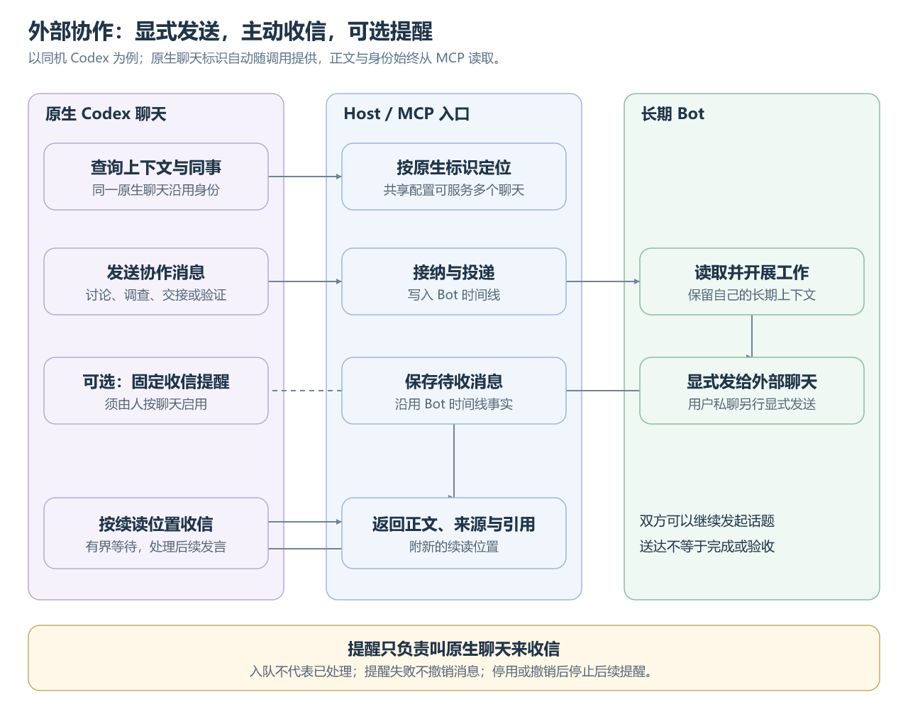

# 外部会话协作

当前支持同机 Codex。Web 和原生聊天共用同一份会话关联。已有的三方发言经 MCP 收发，Bot 的任务委派双向走 A2A。入口复用 Web 的唯一 Host，原生工具拥有自己的上下文、执行环境与生命周期。

外部协作以会话为单位。Web 新建先显示草稿，首条用户消息被 Codex 接纳后登记会话；Bot 发起则在首个 A2A 任务被 Codex 接纳后登记，即便后续没有完成交付。已有本机会话可从 Web 选择或通过 MCP 登记。登记沿用原生身份，Codex 保存标题、正文和执行结果。

Host 到本机 Codex App Server 维持一条经认证的 WebSocket，接入状态由握手和断线事件更新，断线由人点击重连。普通用户消息由人的 Web 入口提交。首次发送结果未知时沿预备的原生 ID 核对，已有输入时直接打开原会话。另一端占用会话时，后到的写入明确反馈忙碌。

## A2A 委派

派单的 Konden Bot 按任务意图决定沿用已关联的 Codex 会话还是新建。A2A 任务和 Codex 会话各自有身份，同一会话可用于不同 Konden Bot 的委派。复用任务沿用原目录并为交付预留当次目录。

两个方向均用 A2A 的 JSON-RPC 与 HTTP 流交换任务状态和文件。Codex 通过已有 MCP 入口发起反向任务，Konden Bot 收到已提交的外部消息，并引用该消息明确交付。已提交的终态回复才会结束委派。发给 Codex 的任务也保留外部来源，同行消息不能扩大人的授权。

Web 从发起委派的对话已提交的结果显示报告和原件副本，交付保留执行所用的 Codex 会话引用。约定文件须齐备才发布成功。失去确定回执时保持未确认，同一来源重试可核对原派单。用法见 [A2A 委派](../../外部协作.md#通过-a2a-委派给-codex)。

## 身份与连接

人从设置生成、命名或撤销接入配置。配置可供多个原生聊天共用，身份取自客户端自动提供的原生聊天标识，同一聊天重连沿用，模型无需保管随机身份。共享原聊天上下文的子执行归原聊天；缺失或无效标识拒绝收发，不猜归属。配置与聊天名称只供人辨认，不参与路由或预选交接人；共用凭据下的身份分流不构成权限隔离。

一个聊天同时使用一份配置；撤销后可换新配置，保留身份、历史与续读位置，自动接续须重开。已有聊天登记后即可查询、寻址和在 Web 联系。外部身份不取得内部成员、工作目录或人的入口权限，也不混入内部 Bot 名册。

Host 拥有身份与接入登记，Bot 和 Web 读同一份；往返消息沿用 Bot 时间线，页面按交流对象投影，不另存聊天事实。重连与 Host 重启不改变已接纳消息、引用或续读位置。

已关联的本机 Codex 会话由 Codex 命名，konden 在读取列表和会话时取得标题。已提交的消息保留当时看到的名称。无法读取标题时显示简短标识，未关联的外部会话可另设显示别名。

## 消息往返

[可编辑图源](images/外部消息往返.svg)。实际接入与收发步骤见[使用指南](../../外部协作.md)。

双方可继续发言或另起话题，无须等待新请求。引用只表达往来关系，不表示完成。相同投递标识重试只接纳一次，改内容属于冲突。版本、证据与验收由参与者和验证 Skill 约定，普通任务不必填验证信息，Runtime 不做语义验收。

Web 允许人在同一个 Codex 聊天与指定一位 Bot 的记录中直接参与。来源固定为人、Codex 和这位 Bot，不接入内部群成员与群级调度，也不建立通用外部群协议。不同 Bot 的三方记录独立；共同可见与请求处理分开，人的发言明确选择接收方，Agent 回复人的消息默认回给人，交给另一位 Agent 须明确选择。

共享记录仍以对应 Bot 时间线中的已接纳消息为唯一事实源。人的入口先接纳共享消息，再向被选中的 Bot 交付真实用户输入，沿原消息身份幂等完成；重启补齐中断的交付，不从是否已经回复推断完成。人的来源由 Web 确定，外部 Agent 不能声明自己是人。页面与模型分别投影共享记录和各自收到的输入，不另存一份群历史。

附件沿用对应 Bot 的 Session 存储，消息记录引用，字节不进入 Journal。Web 上传和 Agent 从工作目录发送的文件保存副本。Agent 发送时先写完整原件，确认发送失败且消息尚未提交时，只回收本次新建且仍由本次发送独占的副本。消息一经接纳，通知失败和原身份重试都保留同一批附件。Codex 的本机文件导入以原生聊天的工作目录为边界，不接受客户端自行声明目录，也不在无法确认目录时放宽范围。接收方按需读取，附件可见性由当前聊天的共享消息决定，不因共用接入配置而扩大；图片呈现和普通文件材料复用既有附件能力，格式解析不归通信层。

## 授权与可见性

建立接入允许已有协作范围内的常规往来，无须逐条确认，人的后续限制优先。外部消息有明确来源，不能替代人的指令、命令批准或其他授权。Codex 只收与自己相关的三方共享消息，无权读用户私聊、内部通信、工具结果与其他群历史；可见消息不等于被请求响应。普通结尾文字给人看，三方内容须显式发送。

Web 呈现往来、联系方式与接入设置。接入配置确认名称后生成，完整配置可再查看。凭据保存在本机配置，常规列表和模型上下文不含凭据。授权、收信方式与提醒结果分别呈现，不用登记或握手推断在线。撤销后停止收发，日常列表收起，身份和历史仍可搜索查看。

人可单独删除外部会话的接入记录，从名册移除并停止该会话收发、等候读取和自动接续；共用连接配置及其他会话不受影响。Bot 时间线中的已提交消息保留，不因清理列表改写事实。原生聊天再次主动调用 `get_context` 可按原身份重新接入，继续读取原有往来，自动接续需重新启用。已经进入 Codex 队列的提醒不能撤回。

## 自动接续与撤销

MCP 支持主动收信与有界等待。人可在 Web 为单个同机 Codex 聊天启用接续，确认本机程序，目标由已识别聊天确定；共用凭据不替代逐聊天授权，外部消息不能指定程序或目标。配置和重试只由人的入口发起。

自动接续只为明确请 Codex 处理的消息发送固定收信提醒，正文和来源从 MCP 读取，不把 Bot 正文提升为人的指令。提醒失败不撤销消息，入队不证明原生端已运行或处理，无法确认就保留未确认。停用或撤销停止后续提醒；不接管客户端生命周期，不承诺打开应用或恢复未加载聊天，也不扩展外部群成员或统一开发会话。
